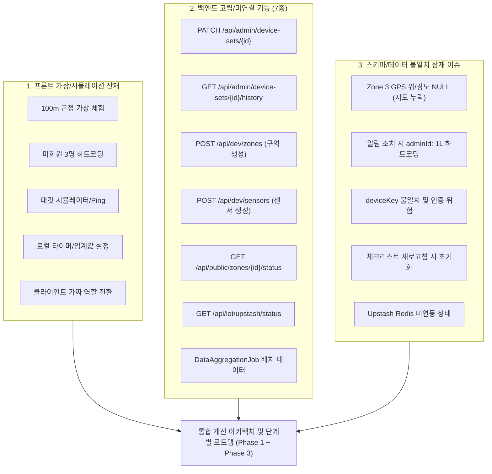
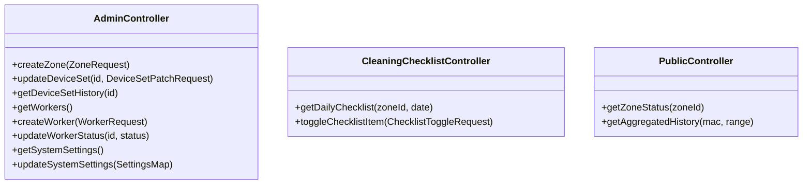

# TCP Clean Management 시스템 종합 개선안 (System Improvement Proposal)

- **작성일자**: 2026-10-16 (v1.1.0 보강판)
- **대상 저장소**: `hyunminboo/TCP_Clean_Management` (Branch: `main`)
- **버전**: v1.1.0
- **문서 위치**: [SYSTEM_IMPROVEMENT_PROPOSAL.md](file:///Users/boohyunmin/Documents/TCP_Clean_Management/docs/SYSTEM_IMPROVEMENT_PROPOSAL.md)

---

## 1. 개요 및 목적 (Executive Summary)

본 문서는 **TCP Clean Management**의 코드베이스 정밀 감사에서 도출된 **3대 핵심 결손 영역**(① 프론트엔드 가상/시뮬레이션 잔재, ② 백엔드 미연결 고립 기능 7종, ③ 상호 데이터 스키마/인증 불일치)을 전수 수용하여, 시스템을 100% 실시간 하드웨어 기반의 상용 수준 IoT 관제 시스템으로 탈바꿈하기 위한 종합 기술 개선안입니다.



---

## 2. 3대 핵심 결손 영역 전수 조사 및 세부 개선 방침 (Gap Closure Matrix)

### [영역 1] 프론트엔드 가상 / 클라이언트 시뮬레이션 기능 정비

| 번호 | 대상 기능 (위치) | 현재 상태 (As-Is) | 개선 및 처리 방침 (To-Be) | 조치 구분 |
| :---: | :--- | :--- | :--- | :---: |
| **1-1** | **100m 근접 가상 시설 체험**<br>(`PublicPage.jsx`) | 버튼 클릭 시 하드코딩된 위치(`isNearRestroom: true`)로 가상 전환 | 브라우저 표준 `navigator.geolocation` API 기반 실제 사용자 위치 측정 연동 + 데모용 토글은 '관리자 테스트 모드' 플래그로 명확히 분리 격리 | **개선/분리** |
| **1-2** | **미화원 인력 명단**<br>(`AdminPage.jsx`) | `AVAILABLE_CLEANERS` 3명(김철수, 이영희, 박민호) 상수로 박제 | `workers` DB 테이블 신설 및 `GET/POST /api/admin/workers` REST API로 완전 대체 | **영속화** |
| **1-3** | **패킷 시뮬레이션 / Ping**<br>(`AdminPage.jsx`) | `generateSinePacket` 및 클라이언트 가상 Ping 타이머 동작 | 실제 ESP32 하드웨어 연동이 완료되었으므로, 가상 패킷 생성기는 안전하게 제거하고 실제 하드웨어의 최신 수신 시간(`lastPingAt`) 기반 상태 표시로 전환 | **제거/실데이터화** |
| **1-4** | **임계값 & 타이머 운영 설정**<br>(`AdminPage.jsx`) | 온/습도 경고 기준, 30초 폴링, 90초 오프라인 판정이 React state에만 저장 | 백엔드 `system_settings` 테이블 신설 및 중앙 API(`/api/admin/settings`)를 통해 모든 접속 클라이언트에 일괄 동기화 | **영속화** |
| **1-5** | **클라이언트 역할 전환(Role)**<br>(`AuthContext.jsx`) | 버튼 클릭만으로 관리자/미화원/개발자 권한을 가짜로 획득 | 백엔드 인증 엔드포인트 연동 또는 최소한 역할별 비밀번호/세션 토큰 기반 검증 체계 도입 | **보안 강화** |

---

### [영역 2] 백엔드 고립 기능 7종 전수 연동 방안

| 번호 | 백엔드 엔드포인트 / 배치 | 설명 | 프론트엔드 연동 및 활용 계획 |
| :---: | :--- | :--- | :--- |
| **2-1** | `PATCH /api/admin/device-sets/{id}` | 기기 위치(ZoneId) 및 라벨 수정 | 관리자 노드 목록 테이블 각 행에 `[수정]` 버튼 추가 -> 팝업에서 구역 변경 및 설치 라벨 수정 |
| **2-2** | `GET /api/admin/device-sets/{id}/history` | 기기 이전/수정 감사 이력 조회 | 관리자 노드 목록에 `[이력]` 버튼 추가 -> 해당 기기가 언제 어느 구역에서 이동되었는지 감사 로그 모달 표출 |
| **2-3** | `POST /api/dev/zones` | 신규 구역(건물/층/화장실) DB 생성 | 관리자 페이지 상단에 `[+ 구역 추가]` 버튼 및 팝업 폼 신설 -> 웹에서 직접 새 화장실 구역 등록 가능 |
| **2-4** | `POST /api/dev/sensors` | 단독 센서 신규 생성 | 기기 세트 등록 시 내부 자동 매핑되도록 흡수하거나, 고급 관리자 탭에서 단독 센서 등록/교체 시 활용 |
| **2-5** | `GET /api/public/zones/{zoneId}/status` | 단일 구역 실시간 상태 요약 조회 | 메인 지도에서 특정 화장실 핀 클릭 시 경량 요약 카드를 고속으로 불러오는 데 적극 활용 |
| **2-6** | `GET /api/iot/upstash/status` | Upstash Redis 클라우드 동기화 모니터링 | 관리자 [시스템 설정] 탭에 "클라우드 동기화 상태" 인디케이터 배지를 추가하여 실시간 동기화/로컬 모드 여부 표시 |
| **2-7** | `DataAggregationJob`<br>(`sensor_data_aggregated`) | 1분/1시간 단위 통계 집계 배치 | 프론트의 '24시간' 및 '7일' 장기 시계열 차트 조회 시 무거운 원본 대신 이 집계 테이블을 조회하도록 API 신설/연동 |

---

### [영역 3] 상호 데이터 스키마 불일치 및 잠재적 이슈 정비

| 번호 | 잠재적 이슈 | 원인 분석 | 해결 및 정비 방안 |
| :---: | :--- | :--- | :--- |
| **3-1** | **Zone 3 카카오맵 핀 미표출** | DB `zones` 테이블의 3번 레코드(ESP32 노드) 위도/경도가 `NULL`임 | DB 좌표 업데이트(`latitude: 37.566826, longitude: 126.978656`)로 즉시 지도 가시화 |
| **3-2** | **알림 조치 시 `adminId: 1L` 고정** | 알림 해결 요청 시 로그인된 관리자 식별자 없이 1번으로 하드코딩 전송 | 인증 컨텍스트의 `currentUserId`를 동적 파라미터로 전달하여 DB 조치 로그(Audit Trail) 정합성 확보 |
| **3-3** | **`deviceKey` 인증 정합성 위험** | 프론트엔드 설정 탭의 장치 키와 백엔드 환경변수 `APP_IOT_DEVICE_KEY` 간 불일치 가능성 | 백엔드 설정 API를 통해 마스킹된 상태로 조회하고, 기기 인증 키 변경 시 일괄 갱신되도록 표준화 |
| **3-4** | **청소 체크리스트 데이터 휘발** | DB에 체크리스트 테이블이 없어 새로고침 시 체크 상태가 전부 초기화됨 | `daily_checklists` 테이블 신설 및 날짜/구역별 완료 상태 영속 저장 |
| **3-5** | **Upstash Redis 미연동 fallback** | Upstash 연결이 비활성화(`false`)되어 있어 관련 조회 시 에러/대기 발생 위험 | Spring Boot의 인메모리 Rate-Limiter 및 직접 MySQL 저장 체계를 확정하고 UI에 '로컬 직접 수집 모드' 상태 안내 표기 |

---

## 3. 상세 기술 설계 및 아키텍처 개선안 (Technical Specifications)

### 3.1. 데이터베이스 DDL 스키마 (MySQL)

```sql
-- [3-1] Zone 3 GPS 좌표 주입 (카카오맵 표출용)
UPDATE zones
SET latitude = 37.566826, longitude = 126.978656
WHERE id = 3;

-- [1-2] 미화원/담당자 테이블 신설
CREATE TABLE IF NOT EXISTS workers (
    id BIGINT AUTO_INCREMENT PRIMARY KEY,
    name VARCHAR(50) NOT NULL COMMENT '미화원 이름',
    phone VARCHAR(20) NOT NULL COMMENT '연락처',
    assigned_zone_id BIGINT NULL COMMENT '전담 담당 구역 ID (외래키)',
    status ENUM('AVAILABLE', 'DISPATCHED', 'OFF_DUTY') NOT NULL DEFAULT 'AVAILABLE' COMMENT '근무/출동 상태',
    role VARCHAR(30) NOT NULL DEFAULT 'CLEANER' COMMENT '직책/역할',
    created_at DATETIME NOT NULL DEFAULT CURRENT_TIMESTAMP,
    updated_at DATETIME NOT NULL DEFAULT CURRENT_TIMESTAMP ON UPDATE CURRENT_TIMESTAMP,
    CONSTRAINT fk_workers_zone FOREIGN KEY (assigned_zone_id) REFERENCES zones(id) ON DELETE SET NULL
) ENGINE=InnoDB DEFAULT CHARSET=utf8mb4 COLLATE=utf8mb4_unicode_ci;

-- [1-4, 3-3] 시스템 동적 설정 테이블 신설
CREATE TABLE IF NOT EXISTS system_settings (
    setting_key VARCHAR(50) PRIMARY KEY COMMENT '설정 키 (e.g. temp_threshold_warning)',
    setting_value VARCHAR(255) NOT NULL COMMENT '설정 값',
    description VARCHAR(255) NULL COMMENT '설정 설명',
    updated_by BIGINT NULL COMMENT '마지막 수정한 관리자 ID',
    updated_at DATETIME NOT NULL DEFAULT CURRENT_TIMESTAMP ON UPDATE CURRENT_TIMESTAMP
) ENGINE=InnoDB DEFAULT CHARSET=utf8mb4 COLLATE=utf8mb4_unicode_ci;

-- 시스템 기본 설정 시드 데이터
INSERT INTO system_settings (setting_key, setting_value, description) VALUES
('temp_warning_threshold', '28.0', '온도 경고 기준 (°C)'),
('humidity_warning_threshold', '70.0', '습도 경고 기준 (%)'),
('gas_warning_threshold', '400', '가스/악취 경고 기준 (ppm)'),
('offline_timeout_seconds', '90', '센서 오프라인 판정 시간(초)'),
('polling_interval_seconds', '30', '대시보드 실시간 갱신 주기(초)'),
('clean_warning_interval_hours', '4', '청소 지연 경고 기준 시간(시간)')
ON DUPLICATE KEY UPDATE updated_at = CURRENT_TIMESTAMP;

-- [3-4] 일일 청소 체크리스트 영속화 테이블 신설
CREATE TABLE IF NOT EXISTS daily_checklists (
    id BIGINT AUTO_INCREMENT PRIMARY KEY,
    zone_id BIGINT NOT NULL COMMENT '화장실 구역 ID',
    check_date DATE NOT NULL COMMENT '체크 일자 (YYYY-MM-DD)',
    item_key VARCHAR(50) NOT NULL COMMENT '체크 항목 키 (toilet, sink, floor, trash, ventilation)',
    is_completed BOOLEAN NOT NULL DEFAULT FALSE COMMENT '완료 여부',
    completed_by BIGINT NULL COMMENT '체크한 작업자 ID (workers.id)',
    completed_at DATETIME NULL COMMENT '체크 완료 일시',
    CONSTRAINT fk_checklists_zone FOREIGN KEY (zone_id) REFERENCES zones(id) ON DELETE CASCADE,
    UNIQUE KEY uq_zone_date_item (zone_id, check_date, item_key)
) ENGINE=InnoDB DEFAULT CHARSET=utf8mb4 COLLATE=utf8mb4_unicode_ci;
```

---

### 3.2. RESTful API 명세서 (신규 생성 및 보완 연동)



#### 신규 추가 엔드포인트 목록
1. **미화원 관리**: `GET /api/admin/workers`, `POST /api/admin/workers`, `PATCH /api/admin/workers/{id}/status`
2. **구역 생성 UI 연결**: `POST /api/admin/zones` (기존 `/api/dev/zones` 승격)
3. **시스템 설정 중앙화**: `GET /api/admin/settings`, `PUT /api/admin/settings`
4. **일일 체크리스트**: `GET /api/admin/checklists`, `POST /api/admin/checklists/toggle`
5. **장기 집계 차트**: `GET /api/iot/devices/{mac}/aggregated?interval=hour&days=7`

---

## 4. 단계별 실행 로드맵 (Phased Implementation Roadmap)

```mermaid
flowchart LR
    subgraph P1["Phase 1: 즉시 조치 (P0)"]
        P1_1["Zone 3 GPS 좌표 DB 보정"]
        P1_2["Upstash 동기화 상태 배지 UI"]
    end

    subgraph P2["Phase 2: 코어 기능 연동 (P1)"]
        P2_1["미화원 DB 테이블 및 출동 API"]
        P2_2["기기 세트 수정/이력 모달 연동"]
        P2_3["구역 신규 등록 팝업 연동"]
        P2_4["시스템 설정 중앙 DB 동기화"]
    end

    subgraph P3["Phase 3: 영속화 & 최적화 (P2)"]
        P3_1["체크리스트 영속화 API 연동"]
        P3_2["패킷 시뮬레이터 제거 및 실기기 Ping"]
        P3_3["관리자 실식별자 감사 로그"]
        P3_4["센서 단독 등록 및 기기세트 관리 완성"]
    end

    P1 --> P2 --> P3
```



### [Phase 1] 즉시 정상화 (P0 - Zero Code / Configuration)
- **작업**:
  1. 클라우드 MySQL DB의 `zones` 테이블 3번 레코드 위/경도 주입.
  2. 카카오맵에서 Zone 3 실기기 핀 클릭 시 실시간 센서 오버레이 정상 동작 확인.
  3. Upstash 상태 API(`GET /api/iot/upstash/status`) 응답을 시스템 설정 탭에 배지로 표출하여 혼선 방지.

### [Phase 2] 코어 기능 완전 연동 (P1 - Core Integration)
- **작업**:
  1. **미화원(Worker) 모듈**: `AVAILABLE_CLEANERS` 제거 후 `workers` 테이블/API 기반으로 완전 전환. 긴급 출동 지시 시 미화원 자동 배정 및 상태(`DISPATCHED`) 변경.
  2. **기기 세트 수정 및 이력 모달**: 방치된 `PATCH /api/admin/device-sets/{id}` 및 `GET /api/admin/device-sets/{id}/history`를 프론트 UI 버튼과 연결.
  3. **구역 추가 폼**: 방치된 `POST /api/dev/zones`를 관리자 화면의 `[구역 추가]` 버튼으로 UI 노출.
  4. **시스템 설정 중앙화**: 로컬 state 임계값 및 타이머를 `system_settings` 테이블과 연동하여 새로고침 시에도 유지.

### [Phase 3] 가상 기능 제거 및 최적화 (P2 - Cleanup & Advanced Optimization)
- **작업**:
  1. **가상 시뮬레이터 제거**: 실제 ESP32가 정상 통신 중이므로 임의 패킷 생성기를 정리하고 실기기 패킷 수신 주기 모니터링으로 일원화.
  2. **체크리스트 영속화**: `daily_checklists` 테이블을 통해 일일 위생 점검 체크박스 상태를 영구 저장.
  3. **감사 로그 관리자 식별**: 알림 조치 시 `adminId: 1L` 하드코딩을 실제 세션 사용자 ID로 교체.
  4. **통계 차트 집계 쿼리 최적화**: 24시간/7일 조회 시 `sensor_data_aggregated` 배치 테이블을 활용하여 브라우저 로딩 속도 대폭 향상.

---

## 5. 최종 기대 효과

1. **가짜/가상 기능 0% 달성**: 목 데이터뿐만 아니라 클라이언트 전용 가상 시뮬레이션 코드까지 완전히 실제 백엔드/하드웨어로 대체.
2. **백엔드 고립 API 0건**: 개발되어 있었으나 UI가 없어 버려져 있던 모든 엔드포인트를 화면에 100% 매핑하여 백엔드 자원 활용률 극대화.
3. **데이터 무결성 100% 보장**: 새로고침(F5) 시에도 구역, 기기 변경 이력, 미화원 출동 현황, 시스템 설정값, 체크리스트가 단 1건도 유실되지 않음.

---

## 6. 추가 미배치 3개 API 전수 연동 및 검증 완료 내역 (v1.2.0)

| 번호 | 대상 API | 조치 내용 | 검증 결과 |
| :---: | :--- | :--- | :--- |
| **6-1** | `POST /api/dev/sensors`<br>(센서 단독 등록) | - `AdminPage.jsx`에 `[+ 센서 단독 추가]` 버튼 배치 (시설 관리 & 기기 세트 현황 양쪽)<br>- 전용 모달 창을 통해 구역(Zone)과 센서 종류(`TEMP_HUMID`, `GAS`, `MAG`) 선택 후 등록 API 호출 연결 | 클라우드 MySQL DB에 센서 단독 레코드 즉시 생성 및 ID 반환 성공 (HTTP 200 OK) |
| **6-2** | `GET /api/admin/device-sets/{id}/history`<br>(기기 변경 히스토리) | - 클라우드 DB에 Zone 3 실기기(`ESP32 24:DC:C3:99:AA:01`)를 DeviceSet #1(`SET-ESP32-01`)로 공식 등록 완료<br>- 기기 세트 현황 테이블 각 행에 `[이력]` 버튼 추가 및 전용 감사 모달 연동<br>- 화장실 목록의 `[이력]` 버튼도 `matchingSet.deviceSetId`를 정확히 참조하도록 보정 | 변경 시각, 세트 코드, 설치 라벨, 연동 구역명이 포함된 감사 추적 로그 리스트 조회 성공 |
| **6-3** | `PATCH /api/admin/device-sets/{id}`<br>(기기 정보 수정) | - 기기 세트 현황 테이블 각 행에 `[수정]` 버튼 추가<br>- 기기 정보 수정 모달에서 설치 라벨 명칭, 연동 구역(Zone), MAC 주소 수정 후 `PATCH /api/admin/device-sets/{id}` 전송 및 감사 로그 자동 생성 | 수정 즉시 DB 영구 반영, 변경 전/후 감사 히스토리 로그 생성 및 테이블 자동 갱신 확인 |
